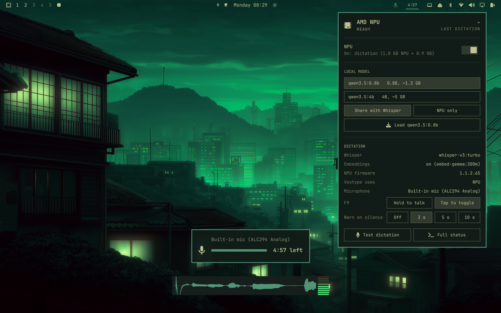
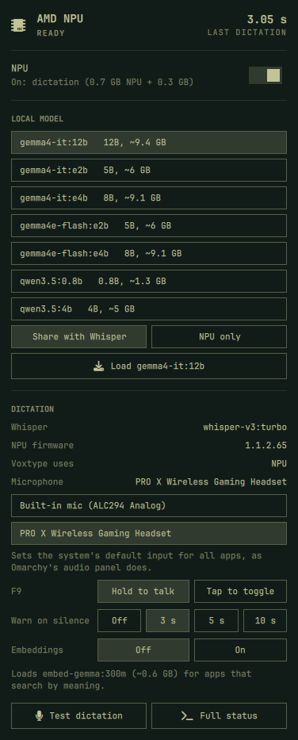
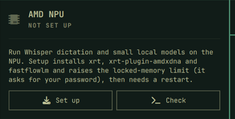
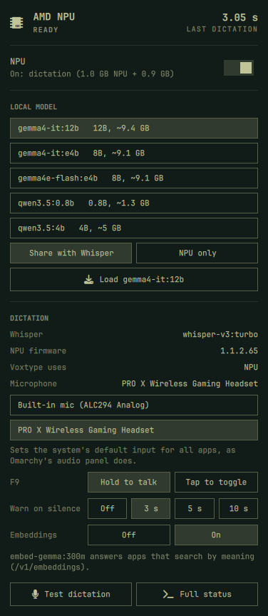
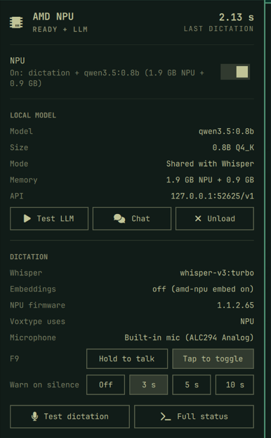
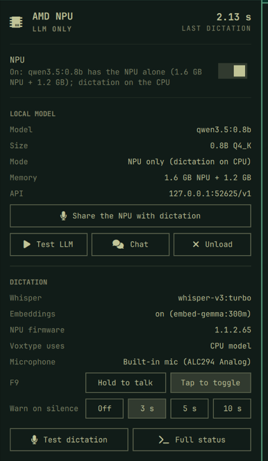
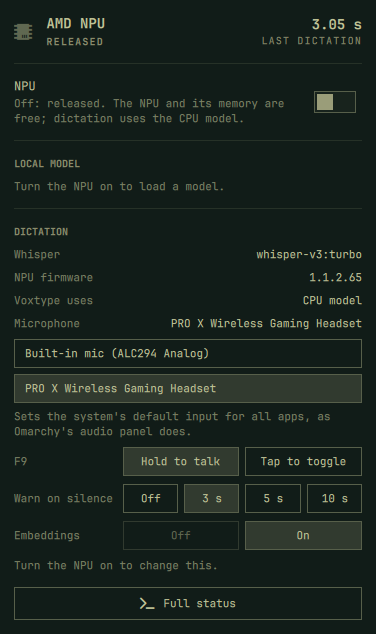

# AMD NPU for Omarchy: dictation and local models

Put the **AMD XDNA2 NPU** in Ryzen AI laptops to work on Omarchy:

- **Dictation.** Omarchy's Voxtype sends your voice to Whisper large-v3-turbo running on the NPU,
  instead of a small model on the CPU.
- **Small local LLMs.** Load models like Qwen3.5 or Gemma 4 on the NPU, either next to Whisper or with
  the NPU to themselves. Use them from other apps (OpenAI and Ollama APIs) or a terminal chat.
- **A bar card** in the style of Omarchy's own panels shows what's running and lets you switch.

<p align="center"></p>

Everything runs on [FastFlowLM](https://github.com/FastFlowLM/FastFlowLM). The CPU and iGPU stay free,
so a big model in LM Studio on the GPU keeps its speed while the NPU works.

## Measured on a ROG Flow Z13 (Ryzen AI MAX+ 395, Omarchy 4)

**Dictation**

| | |
|---|---|
| Dictation (hold F9, speak, release) | ~2.7 s from release to typed text |
| 3 min 19 s recording | transcribed in 34.9 s (**5.7× faster than real time**) |
| CPU / GPU while transcribing | 1–2% / 1% |
| LLM on the GPU (Gemma 4 26B-A4B) while the NPU transcribes | 57.2 → 56.1 tok/s (−2%) |

**Local models on the NPU**

| Model | Generation | Reading a prompt | Load | Memory (NPU + process) | Next to Whisper |
|---|---|---|---|---|---|
| `gemma4-it:e4b` (Gemma 4 E4B: text, images, audio) | **13.7 tok/s** | ~570 tok/s | 12 s | ~10.8 GB | ✓ |
| `gemma4-it:12b` (Gemma 4 12B: text, images, audio) | **6.8 tok/s** | ~310 tok/s | 15 s | ~12.3 GB | ✓ |
| `qwen3.5:4b` | **15.2 tok/s** | ~600 tok/s | 3.3 s | ~6.1 GB | ✓ |
| `qwen3.5:0.8b` | **44.7 tok/s** | ~2,000 tok/s | 1.9 s | ~2.0 GB | ✓ |
| Whisper alone | — | — | — | ~1.0 GB | |

Every model above shares the NPU with dictation; what doesn't fit is Whisper, embeddings and a
model all at once (loading a model pauses embeddings). Gemma 4 measured with FastFlowLM 1.0.9,
generation with ~150-token answers, prompt reading at 2,000-9,000 tokens. For comparison, Gemma 4
E2B ran ~3x faster on the GPU (llama.cpp, Vulkan) but took about twice the energy per answer: use
the NPU to keep the GPU free and the battery happy, the GPU when you're waiting on the answer.

<p align="center"><a href="docs/screenshots/desktop-models.png"></a></p>
<p align="center"><sub>Everything downloaded during testing, in the card (click for the full screen). The flash variants
come with the regular Gemma 4 E2B and E4B: they reuse the same files.</sub></p>

## Requirements

- **An AMD XDNA2 NPU:** Ryzen AI 300 (Strix Point), Ryzen AI MAX (Strix Halo), Krackan Point or
  Gorgon Point. Older XDNA1 NPUs (Phoenix, Hawk Point) aren't supported by FastFlowLM, and
  `amd-npu check` says so.
- **Omarchy (Arch)** with a kernel that has the in-tree `amdxdna` driver (6.14+) and NPU firmware
  ≥ 1.1.0.0 (from `linux-firmware-other`).
- **Voxtype**, for dictation: `omarchy voxtype install`.

**Tested so far on one machine only: ROG Flow Z13 GZ302EA.** Reports from other XDNA2 laptops are
welcome.

## Install

```bash
omarchy plugin add https://github.com/AlanRoman117/omarchy-amd-npu.git --enable
```

Then click the dimmed chip in the bar. The card walks you through setup:



1. **Set up** opens a terminal that installs the NPU runtime (it asks for your password).
2. **Restart** the computer.
3. **Finish setup** downloads Whisper, starts the NPU server and points Voxtype at it. It shows the
   exact Voxtype settings it will change and asks first; `amd-npu disable` puts your own back.

> **What it changes in Voxtype's config** (`~/.config/voxtype/config.toml`, only after you agree):
> - `[whisper]`: `mode = "remote"`, `remote_endpoint = "http://127.0.0.1:52625"`, `remote_model`, and
>   `remote_timeout_secs = 180` if yours is lower. Dictation audio goes to the NPU instead of the CPU model.
> - `[output]`: `pre_recording_command`, the **dictation guard**. As each recording starts it checks that
>   port 52625 belongs to your account, and if it doesn't (another account on the machine took it), it
>   cancels the recording before any audio is sent and tells you why. A `pre_recording_command` you
>   already have keeps running after it.
>
> `amd-npu disable` or `remove` puts all of it back. See [What it changes on your system](#what-it-changes-on-your-system).

On a machine without an XDNA2 NPU the chip stays hidden. Prefer the terminal? The same steps are
`amd-npu install`, a reboot, then `amd-npu enable`, run from
`~/.config/omarchy/plugins/alanroman117.amd-npu/bin/`.

Then **hold F9** (or **Super + Ctrl + X**) to dictate, as usual. Voxtype stops recording after 60 s by
default (Omarchy's setting). For longer dictation, raise `max_duration_secs` in
`~/.config/voxtype/config.toml` (e.g. `300`) and run `systemctl --user restart voxtype`. The NPU
transcribes a minute of speech in about 9 s, and `amd-npu` gives Voxtype a 180 s timeout. Tip: add the CLI to your path with
`ln -s ~/.config/omarchy/plugins/alanroman117.amd-npu/bin/amd-npu ~/.local/bin/`.

Omarchy's plugin installer never runs code or sudo, which is why setup is a separate step you
start yourself.

To update: `omarchy plugin update alanroman117.amd-npu`, then run `amd-npu enable` again so the
service files and the API proxy are refreshed (a changed unit's previous version is kept as one
backup). The card shows **Apply plugin update** when that's needed. Updating to 0.12 from an earlier
version also asks to add the dictation guard to Voxtype (above).

## Local models

```bash
amd-npu models                 # NPU models FastFlowLM offers, and which you've downloaded
amd-npu pull qwen3.5:4b        # download one (asks first; ~3 GB on disk for 4B)
amd-npu load qwen3.5:4b        # load it next to Whisper
amd-npu chat                   # talk to it in the terminal
amd-npu unload                 # back to Whisper only
```

**Two ways to load:**

| | Share with Whisper (default) | NPU only (`--exclusive`) |
|---|---|---|
| Dictation | Keeps working on the NPU | Falls back to Voxtype's CPU model (lower accuracy) |
| Catch | **Dictation waits while the model is answering.** The server runs one request at a time. | You're asked to confirm, and notified when dictation moves to the CPU and back |
| Unload | Back to Whisper only | Whisper returns and dictation moves back to the NPU |

While a model is loaded, other apps can use it at `http://127.0.0.1:52625/v1` (OpenAI API, model name
as shown by `amd-npu models`) or `http://127.0.0.1:52625/api` (Ollama API). In share mode, a long
answer holds up dictation, so keep heavy API use to NPU-only sessions.

Downloads are always a deliberate `amd-npu pull`. The card and `load` only offer models you've already
downloaded; the card's Embeddings **On** opens a terminal for the embedding model's download, which asks
first. (FastFlowLM's server downloads any model a request names, so arbitrary names are refused.)

**Embeddings.** `amd-npu pull embed-gemma:300m`, then `amd-npu embed on`, loads EmbeddingGemma 300M
(about 0.6 GB) next to Whisper, or next to an LLM that has the NPU alone. The card's **Embeddings**
Off / On does the same. The NPU can't hold Whisper,
embeddings and an LLM at once, so loading a model next to Whisper pauses embeddings (the card says
so) and unloading it brings them back. `POST http://127.0.0.1:52625/v1/embeddings` with
`{"model": "embed-gemma:300m", "input": ["..."]}` returns 768-dimensional vectors (inputs up to 2,048 tokens). It shares
the one-request-at-a-time server, so a large batch delays a dictation that lands at the same moment;
keep batches small. `amd-npu embed off` unloads it. The setting survives `unload`, `release`/`resume`
and plugin updates. Apps use it to search notes or documents by meaning rather than exact words; turn
it off when nothing uses it to free the memory.

## The bar card

A chip icon on the right of the bar: bright when the NPU server is up, dimmed when it's stopped,
hidden when it isn't set up. Click it for a card in the style of Omarchy's Wi-Fi, Bluetooth and
power panels:

| Whisper only | Sharing with an LLM | LLM on the NPU alone | Released |
|:---:|:---:|:---:|:---:|
|  |  |  |  |

- **Header:** READY, READY + LLM, LLM ONLY, RELEASED, LOCAL MODEL (Voxtype on its CPU model) or STOPPED, plus
  your last dictation time.
- **NPU:** the on/off switch, showing what the NPU holds (e.g. "On: dictation + gemma4-it:e4b (5.7 GB
  NPU + 4.3 GB)"). Off **releases** the NPU: the server and any model stop, their memory is freed at
  once, dictation moves to Voxtype's CPU model, and it stays off across reboots. On brings Whisper
  back (`amd-npu release` / `resume` do the same). In NPU-only mode, **Share the NPU with dictation**
  brings Whisper back next to the model.
- **Local model:** when loaded, its name, size, mode, memory (NPU buffers + process) and API address,
  with **Test LLM** (generation speed), **Chat** and **Unload**. When nothing is loaded, your downloaded models,
  a Share / NPU only choice, a **Context** size, and **Load** (NPU only asks you to confirm first).
  Context starts at the model's own default (32k for Gemma 4 and Qwen 3.5) and offers 64k, 128k and
  256k up to what the model supports (Gemma 4 E4B: 128k; Gemma 4 12B and Qwen 3.5: 256k; flash models
  stay at 1k). More context holds longer chats and documents, but the NPU memory for it is reserved
  when the model loads: Gemma 4 E4B 5.9 GB at 32k, 6.6 at 64k, 8.0 at 128k; Gemma 4 12B 8.6, 9.2,
  10.2 and 12.2 at 256k, all still next to Whisper. Answers also slow as a long chat fills it. The
  loaded model's details show the context in use.
- **Dictation:** Whisper model, NPU firmware, where Voxtype sends audio, **which microphone** it's
  recording from (red with "(muted)" if that input is muted), **Test dictation** and **Full status**.
  With more than one input, pick one from the list. That sets the system default input, the same as
  Omarchy's audio panel, and Voxtype uses it from the next dictation. The laptop's own mic is labelled
  "Built-in mic". If Voxtype's config locks dictation to one device (`[audio] device`), the card shows
  that device instead of the list.
  **F9** switches between **Hold to talk** (Omarchy's push-to-talk) and **Tap to toggle** (tap once to
  start, again to stop; the recording limit and the countdown still apply).
- **Embeddings:** Off / On loads or unloads the embedding model (see above), with a line saying what it's
  doing. Loading a model next to Whisper pauses embeddings (On stays lit, and they come back when you
  unload it, even after switching it to NPU only); with a shared model already loaded, On waits until
  it's unloaded. Turning it on or off restarts the
  NPU server, so dictation pauses for a few seconds.
- **On smaller or scaled screens** the card scrolls (mouse wheel, touch drag, Up/Down or j/k) when it's
  taller than the space under the bar, and a scrollbar flashes when it opens to say there's more.

**Chat** opens a floating terminal with `amd-npu chat` for a quick question or a short summary:
paste the text (newlines and all, it goes as one message) and ask. `/exit` or Ctrl+D closes the
window. It's a local terminal client, so the browser protection below stays as it is. To open it
from a key, bind `omarchy-shell alanroman117.amd-npu chat`.

**While you hold F9**, a countdown shows how long you can keep talking before Voxtype's recording
limit (`max_duration_secs`):
- **On-screen overlay:** the microphone's name on top, then a mic icon, a bar that drains, and
  "4:37 left". The name follows the mic live: unplug a headset mid-sentence and it switches to the
  mic PipeWire moved the recording to. If the mic sends no sound for 3 seconds (switched off, boom
  muted, or a headset still reconnecting after you plug it in), the name turns red and adds
  "- no sound", clearing as soon as sound arrives. Change the delay, or turn it off, under
  **Warn on silence** on the card (Off / 3 s / 5 s / 10 s; kept in `~/.config/amd-npu/card.json`).
  It's only a hint: the recording keeps going. In the last 15 seconds it reads "0:12 left - finishing soon".
- **The chip in the bar** turns into the time, and switches to the warning colour near the end.
- **After you let go,** the overlay says "Transcribing..." until the text arrives. With a model loaded
  next to Whisper, the NPU answers one request at a time, so a dictation sent while the model is writing
  an answer waits for it to finish; the overlay then says **"Waiting for the model's answer..."** until
  the NPU is free. Nothing is lost. To dictate during long answers, load the model **NPU only**
  (dictation moves to the CPU model).

The countdown places itself just above Voxtype's waveform, wherever Voxtype's `[osd]` settings put
it (below it if the waveform is near the top, Omarchy's usual overlay spot if it's in a corner), so
nothing needs moving. With more than one monitor it shows on the focused one, like the waveform.

Voxtype works out where to draw its waveform once, from the screen it started on, so after you plug
in or unplug a monitor it can end up off-screen. The card notices screen changes and restarts
Voxtype's waveform overlay (only while you're not dictating; Voxtype brings it back within a
second or two). To do it by hand: `omarchy-shell alanroman117.amd-npu fixWaveform`.

Recording and transcribing states are also shown by Omarchy's built-in dictation indicator.

## Commands

| Command | What it does |
|---|---|
| `amd-npu check` | Is this machine supported, and what's installed? |
| `amd-npu setup-state` | One word for the bar card: `unsupported`, `driver`, `install`, `reboot`, `enable` or `installed` |
| `amd-npu install` | Installs `xrt`, `xrt-plugin-amdxdna` and `fastflowlm`, and lifts the memlock limit for your account only (sudo; reboot after) |
| `amd-npu enable [--yes]` | Downloads Whisper (620 MB, asks first), starts `amd-npu.service`, and, after showing the change and asking, points Voxtype at it. Your previous Voxtype values are saved. Also applies a plugin update's new proxy and service files. Safe to re-run. |
| `amd-npu status [--json]` | Server, Whisper, firmware, Voxtype backend, last dictation, loaded model, memory |
| `amd-npu doctor` | `status`, browser-protection checks, and a live transcription request |
| `amd-npu ping` | Quiet Whisper check: `ok <seconds>` or `fail <reason>` |
| `amd-npu models [--json]` | NPU LLMs FastFlowLM offers, with size, memory and download state |
| `amd-npu pull <model>` | Download a model (asks first) |
| `amd-npu load <model> [--exclusive] [--ctx N]` | Load next to Whisper, or alone with dictation on the CPU. `--ctx` is `-1` (model default) or 512 up to the model's own limit (the card's **Context** row); if the server won't start, the previous settings are restored |
| `amd-npu unload` | Drop the model; Whisper only, dictation back on the NPU |
| `amd-npu chat [model] [--think]` | Streaming terminal chat; a multi-line paste is one message (`/reset`, `/exit`, Ctrl+C stops an answer). FastFlowLM's flash models (`*-flash`) answer each message on its own |
| `amd-npu bench-llm [--raw]` | Measure the loaded model's generation speed |
| `amd-npu embed on\|off\|status` | Load or drop the embedding model (`embed-gemma:300m`) next to Whisper; `/v1/embeddings` through the proxy. If the server won't start with it, the previous settings are restored |
| `amd-npu release` | Frees the NPU and its memory (Whisper and any LLM); dictation uses Voxtype's CPU model; stays off across reboots |
| `amd-npu resume` | Brings Whisper back on the NPU and dictation with it |
| `amd-npu hide-npu <command>` | Runs a program with the NPU hidden from it, e.g. a ROCm app (see below) |
| `amd-npu f9 toggle` / `hold` | Tap F9 to start and tap again to stop, or back to holding it (Omarchy's default); the card's **F9** row does the same |
| `amd-npu disable` | Puts Voxtype's own `[whisper]` settings back, removes the dictation guard and stops the server (frees the NPU and port 52625) |
| `amd-npu remove` | `disable` + delete the services; asks before deleting models, settings, old backups, packages and the memlock setting |

## What it changes on your system

- **Packages:** `xrt`, `xrt-plugin-amdxdna`, `fastflowlm` (all from Arch `extra`).
- **Memlock:** the NPU runtime needs unlimited locked memory. One file, naming only your account:
  `/etc/security/limits.d/90-amd-npu-memlock.conf`. (Versions before 0.8 also wrote two systemd
  drop-ins that applied to every account; `amd-npu install` and `remove` delete them.)
- **Services:** `~/.config/systemd/user/amd-npu.service` (FastFlowLM on `127.0.0.1:6669`),
  `amd-npu-proxy.service` (the API on `127.0.0.1:52625`, running `~/.local/share/amd-npu/proxy.py`) and
  `amd-npu-proxy.socket`, which keeps port 52625 bound for your account through every restart and
  while the NPU is released (systemd hands it to the proxy).
  Both are sandboxed: read-only system and home (FastFlowLM can't write its models folder), private
  `/tmp`, no extra privileges or capabilities, and a system-call filter; `systemd-analyze --user
  security amd-npu` rates them 1.8 ("OK"). Settings live in `~/.config/amd-npu/server.env` (which
  model, Whisper on or off, context length, allowed browser origins) and `card.json` (the silence
  warning).
- **Models:** `~/.config/flm/models/`.
- **Voxtype config,** only after you agree: in `~/.config/voxtype/config.toml`, `[whisper]` gets
  `mode = "remote"`, `remote_endpoint = "http://127.0.0.1:52625"` and `remote_model`, plus
  `remote_timeout_secs = 180` if yours is lower. The endpoint has no `/v1`; Voxtype adds it.
  NPU-only mode sets `mode = "local"` until you unload. (Voxtype 1.1 renamed the old `backend` key to
  `mode`; `mode` wins when both are present. amd-npu writes `mode`, removes `backend`, and renames
  it on `enable` if your config still has it.) Your original values and the first and
  latest copies of the file are kept in `~/.config/amd-npu/voxtype/`, and `disable`/`remove` put
  the originals back. Edits are atomic and follow a symlinked config (dotfile managers keep working).
  `[output]` gets `pre_recording_command = "python3 ~/.local/share/amd-npu/dictation-guard.py"` (the
  dictation guard, see [Good to know](#good-to-know)); if you already had a command there, it's kept and
  runs after the guard, and `disable`/`remove` take only the guard out.
- **F9 mode,** only when you pick **Tap to toggle**: one file,
  `~/.local/state/omarchy/toggles/hypr/amd-npu-f9-toggle.lua`, which unbinds Omarchy's two F9
  push-to-talk bindings and binds F9 to `voxtype record toggle`. Omarchy loads that folder after your
  own bindings, the same way its own toggles work; your `bindings.lua` isn't touched. **Hold to talk**
  (or `amd-npu remove`) deletes the file and reloads Hyprland.
- **Microphone:** the card's mic picker changes the system default input for all apps, like
  Omarchy's audio panel; nothing changes unless you pick one.

## Good to know

- **The NPU server holds the NPU exclusively.** Other NPU tools (`flm run`, Lemonade) need the NPU
  released first (switch it off, or `amd-npu release`).
- **Two programs on the NPU can crash its driver** (amdxdna in Linux 7.2). ROCm programs open the NPU
  too, not just the GPU: LM Studio's ROCm engine, llama.cpp HIP builds, anything using ROCm's runtime.
  If one is stopped at the wrong moment while the NPU server holds the NPU, the driver can oops. After
  that, any program touching the NPU hangs and can't be killed, and **shutdown hangs** on it. See
  "Running ROCm apps next to the NPU server" below. If it happens anyway:
  - the card shows **NPU STUCK**;
  - every amd-npu command that would start, stop or load on the NPU refuses (it would hang too);
  - the only fix is a reboot. Save your work first. If shutdown sits on the logo for more than a few
    minutes, hold the power button.

  amd-npu also refuses to start, stop or load while another of your programs has the NPU open
  (`--force` overrides), and the card warns about it.
- **If the server is stopped, dictation fails** until it's started again, or you release the NPU
  (dictation then uses Voxtype's CPU model).
- **Plugging a mic in mid-dictation can leave that dictation silent.** Unplugging is fine: PipeWire
  moves the recording to the next mic and it carries on. But when a mic is plugged in (or a wireless
  headset's receiver goes back in), PipeWire makes it the default and moves the live recording onto
  it, and on that moved recording some devices send only silence. The countdown shows
  "- no sound"; let go of F9 and press it again, and the new dictation uses the mic normally. This
  plugin leaves PipeWire's device switching alone rather than change system behaviour.
- **Don't force NPU firmware versions or install `amdxdna-dkms`** on a current kernel. A mismatch can
  make the NPU disappear.
- **The API on `127.0.0.1:52625` has no password, but only your account can use it.** The proxy looks
  up who owns each incoming connection and closes other accounts' connections immediately; your own
  are capped at 32 at once. (FastFlowLM's internal port 6669 has no such check; browsers can't
  reach it, but other local accounts can.) Each connection the proxy opens to FastFlowLM is checked
  before anything is sent on it: the server end of that exact connection must belong to your account,
  so if FastFlowLM exits and another account takes its port, requests are refused, not handed over.
- **Dictation only goes to your own account's port.** Voxtype talks plain HTTP and can't check who
  answers on 52625, so on a shared machine another account holding that port would get your audio and
  choose the text that gets typed. Two things stop that:
  - **The port is never free.** `amd-npu-proxy.socket` keeps it bound for your account while your
    session runs (from boot if lingering is on, `loginctl enable-linger`), including during server
    restarts, plugin updates and while the NPU is released, so there's no gap to take it in.
  - **The dictation guard** (Voxtype's `pre_recording_command`) checks the port's owner as each recording
    starts and cancels the recording, before any audio is sent, if it isn't you: for example if another
    account bound the port before you logged in. You get a notification, the card shows **PORT TAKEN**
    and `amd-npu doctor` says what's wrong.
- **Web pages can't use it.** FastFlowLM itself listens on `127.0.0.1:6669`, a port browsers refuse
  to connect to. The proxy on 52625 forwards only the API routes clients need (chat, completions,
  embeddings, transcription, model listing). It refuses requests from web pages (any origin not on
  your allowlist), plain-text tricks, unexpected `Host` headers (DNS rebinding), malformed or
  duplicated lengths, models that aren't downloaded and a `backend` override (FastFlowLM 1.0.9 would
  reload the model on whatever runtime it names). It also strips FastFlowLM's "readable by any
  site" CORS header. `amd-npu doctor` checks this. To let a browser-based chat UI in, list its
  origin in `~/.config/amd-npu/server.env`, e.g. `AMD_NPU_ALLOWED_ORIGINS=http://localhost:8080`,
  then run `systemctl --user restart amd-npu` (`*` is ignored on purpose).
- **Requests can't download models.** `/api/pull` and FastFlowLM's other management routes aren't
  forwarded, and the server can read the models folder but not write it, so downloads only happen
  through `amd-npu pull` (or `enable` for Whisper), after asking. A program that calls FastFlowLM's
  port directly with a missing model makes it hang instead (seen with FastFlowLM 1.0.4); `systemctl
  --user restart amd-npu` recovers.
- **Where models come from:** FastFlowLM downloads them from Hugging Face (with a ModelScope
  mirror), following each repository's current files. There are no pinned versions or checksums, so
  you're trusting those upstream repositories; amd-npu never downloads without asking.
- **After `omarchy plugin update`,** the card shows **Apply plugin update** if the update changed the
  proxy or service files; it runs `amd-npu enable`.

## Running ROCm apps next to the NPU server

ROCm's runtime opens every AMD AI Engine device it finds, so a GPU app like LM Studio or a llama.cpp
HIP build also opens the NPU. Two ways to keep them apart:

1. **Release the NPU first:** switch it off in the card (or `amd-npu release`), run your GPU work, then
   switch it back on. Dictation keeps working on Voxtype's CPU model meanwhile.
2. **Start the app with the NPU hidden:** `amd-npu hide-npu <command>` runs it in a bubblewrap
   sandbox where `/dev/accel` and `/sys/class/accel` are empty, so ROCm sees only the GPU. Everything
   else stays as it is. For example:

   ```bash
   ~/.config/omarchy/plugins/alanroman117.amd-npu/bin/amd-npu hide-npu ~/Applications/llama.cpp/build/bin/llama-server -m model.gguf
   ```

   For a desktop launcher, put the same prefix in front of the app's `Exec=` line in your own copy of
   its `.desktop` file (`~/.local/share/applications/`). amd-npu never edits launchers. This needs
   `bubblewrap` (`omarchy pkg add bubblewrap`). It has been tested to hide the device; whether a
   particular app (for example an AppImage that mounts itself with FUSE) runs inside the sandbox
   depends on the app.

## Uninstall

```bash
~/.config/omarchy/plugins/alanroman117.amd-npu/bin/amd-npu remove
omarchy plugin remove alanroman117.amd-npu
```

## Licences

This repo is MIT. FastFlowLM's orchestration code is MIT, and its NPU kernels ship under
FastFlowLM's own free-to-use binary licence (installed from Arch's `extra` repo, not bundled here).
Models keep their own licences (Whisper: MIT; Qwen, Gemma and others: see each model card).
